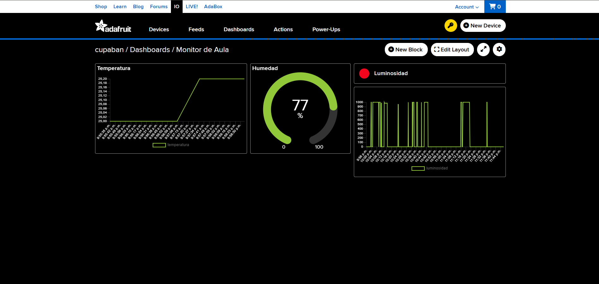
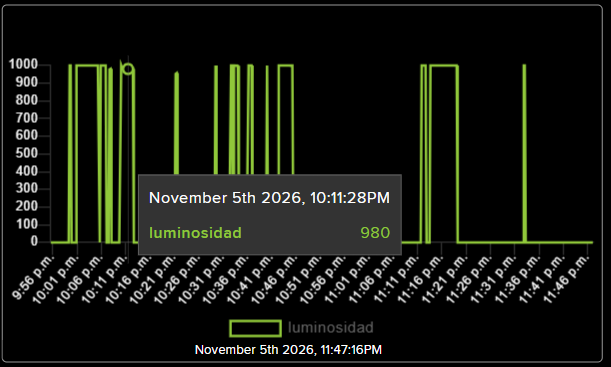
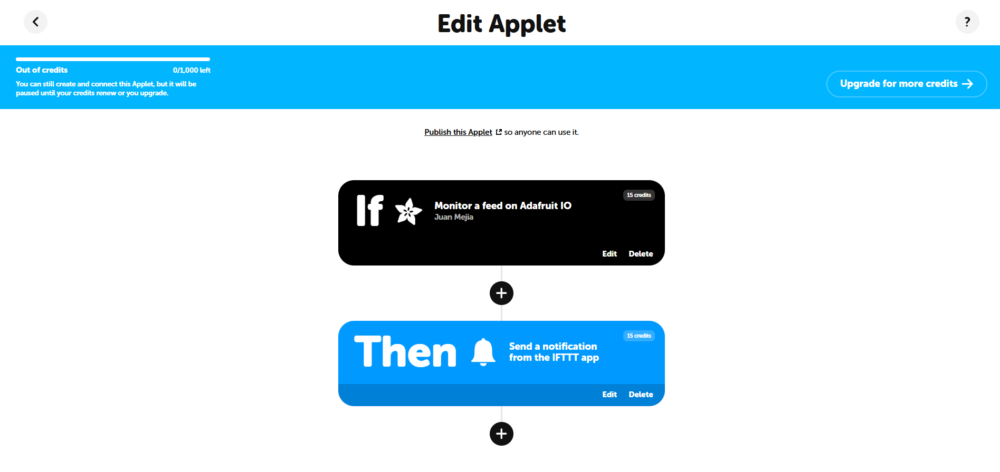
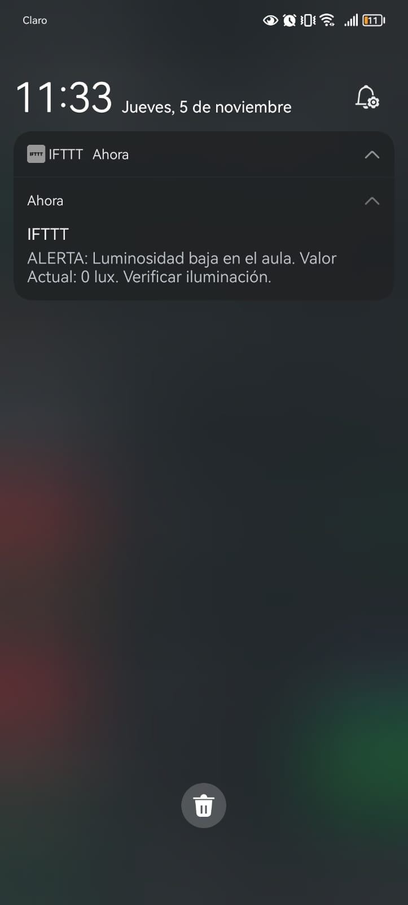

# Sistema IoT de Notificación de Anomalías Ambientales (Semana 13)

**Autores:** Juan Diego Cupaban Mejía & Andrea Vanessa Fonseca Gómez  
**Institución:** Unidades Tecnológicas de Santander (UTS)  
**Asignatura:** Internet de las Cosas (IoT)

## 1. Descripción del Proyecto
Este proyecto implementa un flujo completo de IoT para el monitoreo de iluminación en un aula de clases. El sistema captura los datos de luminosidad mediante un microcontrolador ESP32 y un sensor LDR (configurado para lectura digital), publica los datos en un broker en la nube (Adafruit IO) mediante el protocolo MQTT, y utiliza la plataforma IFTTT para automatizar una alerta. Si el sistema detecta que la luz del aula cae a 0 (oscuridad o anomalía), el coordinador académico recibe una notificación push en su celular.

## 2. Diagrama de Conexión y Flujo de Datos

**Flujo lógico:**
`Sensor LDR` $\rightarrow$ `ESP32` $\rightarrow$ `Adafruit IO (MQTT)` $\rightarrow$ `IFTTT (Trigger)` $\rightarrow$ `Notificación Push`

**Conexión de Hardware:**
*   **Sensor LDR (Módulo de 3 pines):**
    *   Pin VCC $\rightarrow$ 3.3V del ESP32
    *   Pin GND $\rightarrow$ GND del ESP32
    *   Pin DO (Digital Out) $\rightarrow$ GPIO 34 del ESP32

## 3. Evidencias y Capturas de Pantalla

### 3.1. Dashboard en Adafruit IO

> **Descripción de la captura:** Se muestra el entorno general del dashboard en Adafruit IO, donde se ve el bloque creado para el proyecto (LINE CHART).

### 3.2. Gráfico Histórico (Tendencia de Luminosidad)

> **Descripción de la captura:** Acercamiento al widget "Line Chart" en Adafruit. Se aprecia claramente la línea saltando entre 1000 (luz) y 0 (oscuridad) a lo largo del tiempo.

### 3.3. Configuración del Applet en IFTTT

> **Descripción de la captura:** Se muestra la pantalla de IFTTT donde se ven las tarjetas conectadas: el "If" (Adafruit Monitor a feed) y el "Then" (Send a notification from the IFTTT app).

### 3.4. Notificación Push Recibida

> **Descripción de la captura:** Se evidencia el pantallazo de la barra de notificaciones del celular donde se lee claramente el mensaje: "ALERTA: Luminosidad baja en el aula. Valor actual: 0 lux. Verificar iluminación".

## 4. Código Fuente
El código fuente utilizado para este proyecto se encuentra en la carpeta `codigo/` bajo el nombre `esp32_luminosidad.ino`. Se implementó lógica no bloqueante utilizando `millis()` para mantener viva la conexión MQTT y se adaptó la lectura del sensor LDR a modo digital.

## 5. Conclusiones sobre la automatización en IoT
La automatización mediante plataformas de terceros como IFTTT permite desvincular la lógica de negocio (las reglas de alertas) de la capa de hardware. El microcontrolador (ESP32) se dedica exclusivamente a la adquisición y transmisión eficiente de datos. Esto es fundamental en sistemas IoT porque permite cambiar las reglas, los mensajes, o los destinatarios de las alertas desde la nube sin necesidad de detener, reprogramar o acceder físicamente a los dispositivos en las aulas.