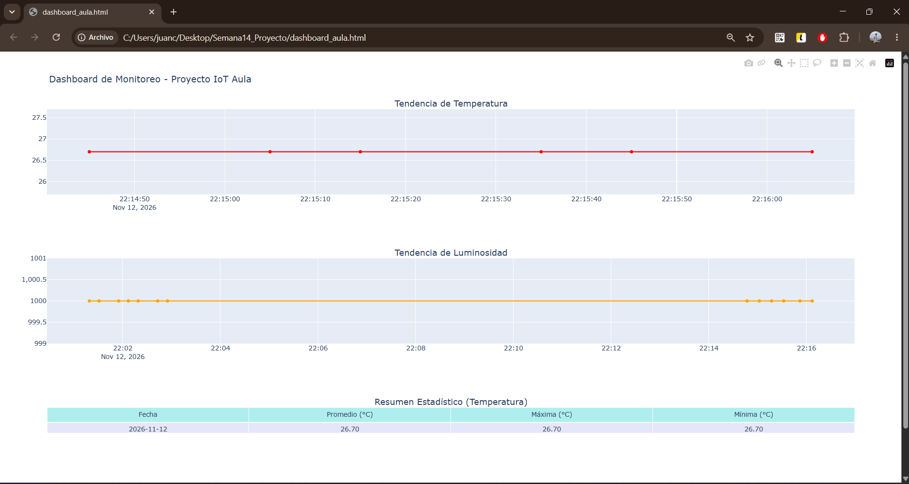
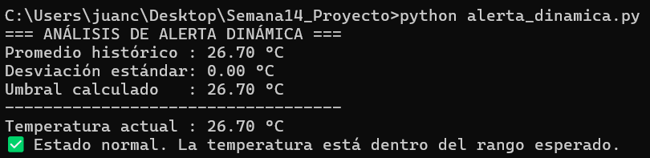
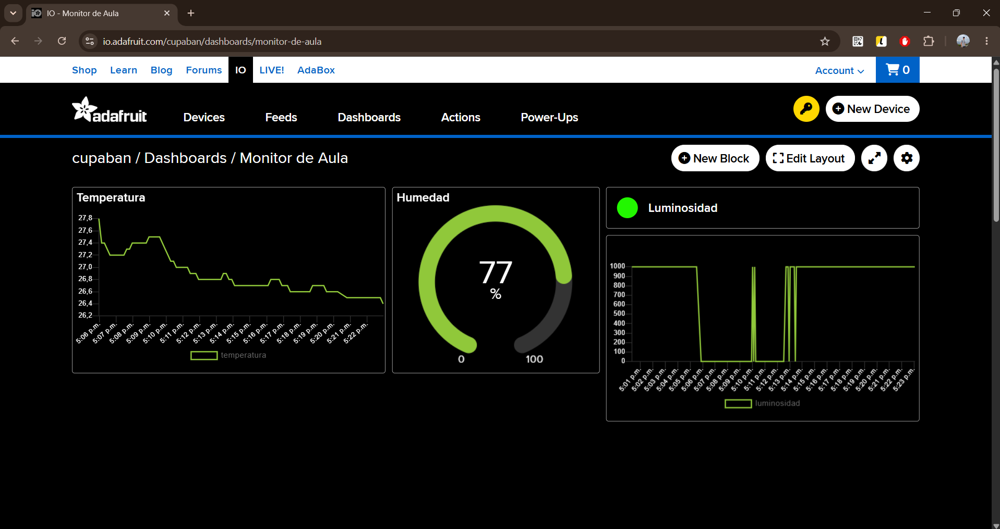

# 🏫 Proyecto IoT - Semana 14: Almacenamiento Avanzado y Visualización

**Autores:** Juan Diego Cupaban Mejía & Andrea Vanessa Fonseca Gómez  
**Institución:** Unidades Tecnológicas de Santander (UTS)  
**Asignatura:** Internet de las Cosas (IoT)  

Este repositorio contiene la implementación de la Fase de Almacenamiento Avanzado y Visualización Histórica Detallada para el monitoreo ambiental del aula (`AULA-101`), superando el límite de retención de 30 días de los planes gratuitos en la nube.

---

## 🚀 Tecnologías Utilizadas
* **Hardware:** Microcontrolador ESP32, Sensor DHT11 (Temperatura), Sensor LDR digital (Luminosidad), LED y Buzzer de alerta local.
* **Nube y Protocolo:** Adafruit IO (Broker MQTT).
* **Almacenamiento Local:** Base de datos relacional **SQLite** (`historico_aula.db`) para persistencia local ilimitada.
* **Análisis y Visualización:** Python (`requests`, `pandas`, `plotly`).

---

## ⚙️ Instrucciones de Instalación y Ejecución
Para ejecutar este proyecto en cualquier computadora con Python instalado, sigue estos pasos:

1. Clonar o descargar este repositorio.
2. Instalar las dependencias necesarias ejecutando en la terminal:
   ```bash
   pip install requests pandas plotly
   ```
3. Abrir el archivo `scripts/almacenamiento_sqlite.py` y configurar tus credenciales reales (`AIO_USERNAME` y `AIO_KEY`).
4. Ejecutar los scripts en el siguiente orden:
   * **Ingesta de datos:** `python scripts/almacenamiento_sqlite.py`
   * **Generar Dashboard:** `python scripts/generar_dashboard.py`
   * **Verificar Alertas:** `python scripts/alerta_dinamica.py`

---

## 📂 Contenido del Repositorio
* `scripts/`: Contiene el código de ingesta continua hacia SQLite, el generador del dashboard interactivo en HTML y el algoritmo de alertas inteligentes con umbral dinámico.
* `dashboards/`: Contiene el archivo interactivo `dashboard_aula.html` exportado.
* `docs/`: Evidencias visuales del funcionamiento del sistema.

---

## 📊 Evidencias de Funcionamiento

### 1. Visualización: Dashboard Histórico (3 Paneles)
*Se evidencia la tendencia de temperatura, la tendencia de luminosidad y la tabla de resumen estadístico (promedio, máximo y mínimo) calculados a partir de la base de datos SQLite.*



### 2. Alertas Inteligentes: Umbral Dinámico
*En lugar de utilizar un límite fijo, el sistema calcula dinámicamente el umbral a partir del histórico ($\text{Promedio} + 2 \times \text{Desviación Estándar}$) para detectar anomalías reales según el comportamiento del aula.*



### 3. Persistencia: Histórico en la Nube
*Datos continuos recibidos desde el ESP32 en los feeds de luminosidad y temperatura de Adafruit IO, garantizando la recolección en tiempo real antes de su almacenamiento local.*

