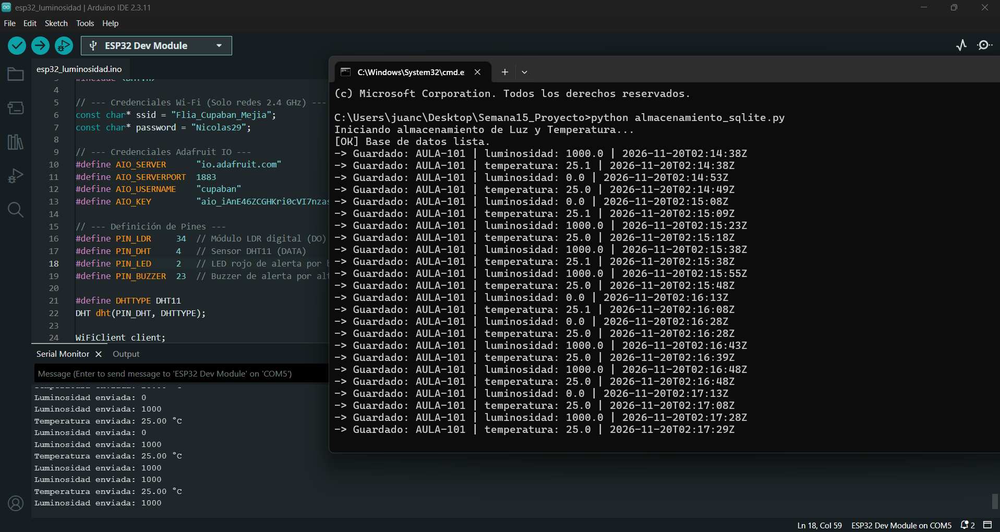
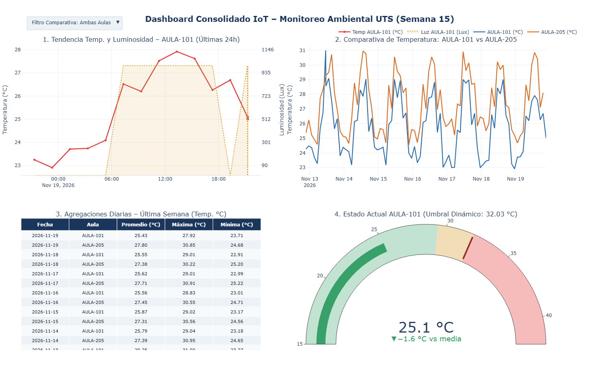
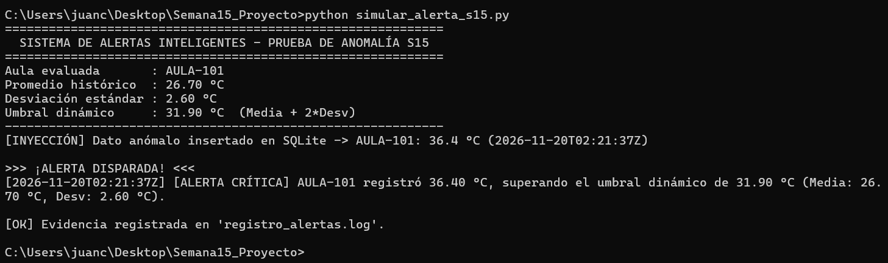
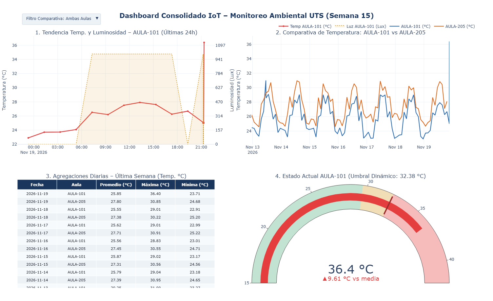

# 🏫 Proyecto IoT - Semana 15: Consolidación del Dashboard y Alertas Inteligentes

**Autores:** Juan Diego Cupaban Mejía & Andrea Vanessa Fonseca Gómez  
**Institución:** Unidades Tecnológicas de Santander (UTS) — Bucaramanga, Santander  
**Asignatura:** Internet de las Cosas (IoT) — Cierre del Proyecto Integrador

Este repositorio contiene la consolidación técnica de la **Semana 15**, integrando el flujo completo de telemetría ambiental desde el nodo físico (`ESP32`) hacia la nube (`Adafruit IO`), persistencia local ilimitada (`SQLite`), un **dashboard interactivo de 4 paneles** (`Plotly`) y un **sistema de alertas inteligentes basado en umbrales dinámicos** ($\mu + 2\sigma$) con simulación de anomalías.

---

## 🏗️ Arquitectura del Sistema

$$\text{ESP32 (DHT11 + LDR)} \xrightarrow{\text{MQTT}} \text{Adafruit IO} \xrightarrow{\text{API REST}} \text{Python + SQLite} \longrightarrow \text{Dashboard 4 Paneles (Plotly) \& Alertas Dinámicas}$$

* **Hardware:** Microcontrolador ESP32 DevKit, sensor DHT11 (`GPIO 4`), módulo LDR digital LM393 (`GPIO 34`), LED rojo (`GPIO 2`) y buzzer activo (`GPIO 23`).
* **Nube:** Broker MQTT y API REST v2 de **Adafruit IO** (`luminosidad` y `temperatura`).
* **Almacenamiento Local:** Base de datos relacional embebida **SQLite** (`historico_aula.db`), compatible conceptualmente con despliegues en **InfluxDB**.
* **Visualización y Analítica:** Python 3 con `requests`, `pandas` y `plotly` (exportación interactiva en HTML).

---

## ⚙️ Instrucciones de Instalación y Despliegue

### Opción A: Despliegue Local Implementado (Python + SQLite + Plotly)

1. Clonar el repositorio y entrar a la carpeta `Semana15/scripts/`.
2. Instalar las dependencias de Python:
   ```bash
   pip install requests pandas plotly
   ```
3. Configurar tus credenciales de Adafruit IO (`AIO_USERNAME` y `AIO_KEY`) en `almacenamiento_sqlite.py` y las credenciales Wi-Fi ($2.4\text{ GHz}$) en `esp32_aula_monitoreo.ino`.
4. Ejecutar el flujo de pruebas en orden:
   ```bash
   python almacenamiento_sqlite.py   # 1. Ingesta real desde Adafruit IO (detener con Ctrl+C)
   python poblar_datos_s15.py        # 2. Genera histórico semanal (7 días) y AULA-205
   python dashboard_s15.py           # 3. Exporta dashboard_consolidado_s15.html (4 paneles)
   python simular_alerta_s15.py      # 4. Inyecta anomalía térmica y dispara alerta en log
   python dashboard_s15.py           # 5. Actualiza el dashboard para ver el Gauge en rojo
   ```

### Opción B: Despliegue Alternativo de Producción (InfluxDB + Grafana con Docker Compose)

Para entornos institucionales escalables a múltiples aulas, la misma arquitectura puede levantarse con **InfluxDB v2** y **Grafana** creando un archivo `docker-compose.yml`:

```yaml
version: "3.8"
services:
  influxdb:
    image: influxdb:2.7
    container_name: iot_influxdb
    ports:
      - "8086:8086"
    environment:
      - DOCKER_INFLUXDB_INIT_MODE=setup
      - DOCKER_INFLUXDB_INIT_USERNAME=admin
      - DOCKER_INFLUXDB_INIT_PASSWORD=password123
      - DOCKER_INFLUXDB_INIT_ORG=uts
      - DOCKER_INFLUXDB_INIT_BUCKET=aulas
      - DOCKER_INFLUXDB_INIT_ADMIN_TOKEN=mi-token-secreto-uts
    volumes:
      - influxdb_data:/var/lib/influxdb2

  grafana:
    image: grafana/grafana:latest
    container_name: iot_grafana
    ports:
      - "3000:3000"
    depends_on:
      - influxdb
    environment:
      - GF_SECURITY_ADMIN_USER=admin
      - GF_SECURITY_ADMIN_PASSWORD=admin
    volumes:
      - grafana_data:/var/lib/grafana

volumes:
  influxdb_data:
  grafana_data:
```

Levantar ambos servicios desde la terminal con:
```bash
docker compose up -d
```
* **InfluxDB:** disponible en `http://localhost:8086` (Org: `uts`, Bucket: `aulas`).
* **Grafana:** disponible en `http://localhost:3000` (conectar Data Source tipo InfluxDB usando Flux y el token configurado).

---

## 🧠 Lógica del Umbral Dinámico

A diferencia de un límite estático (por ejemplo, alertar siempre que $T > 30\,^\circ\text{C}$), el sistema calcula un umbral adaptativo a partir de la distribución estadística del histórico del aula:

$$\text{Umbral Preventivo} = \mu + \sigma \qquad \text{y} \qquad \text{Umbral Dinámico Crítico} = \mu + 2\sigma$$

Donde $\mu$ es el promedio histórico de temperatura del aula y $\sigma$ es su desviación estándar poblacional. Bajo una distribución normal, aproximadamente el $95.4\%$ de las lecturas habituales permanecen dentro de $\mu \pm 2\sigma$:

* **Zona Verde ($T < \mu + \sigma$):** Operación térmica normal.
* **Zona Amarilla ($\mu + \sigma \le T \le \mu + 2\sigma$):** Variación preventiva bajo observación.
* **Zona Roja ($T > \mu + 2\sigma$):** Anomalía estadística confirmada; se dispara la alerta y se persiste el evento en `registro_alertas.log`.

---

## 📂 Estructura del Repositorio

* `scripts/`: Firmware `esp32_aula_monitoreo.ino` y scripts de ingesta (`almacenamiento_sqlite.py`), generación de histórico (`poblar_datos_s15.py`), tablero interactivo (`dashboard_s15.py`) y simulación de alertas (`simular_alerta_s15.py`).
* `dashboards/`: Archivo interactivo `dashboard_consolidado_s15.html` con los 4 paneles y selector de aulas.
* `docs/`: Capturas de evidencia, registro `registro_alertas.log` e informe técnico en Word (`Documentacion_Actividad_IoT_Semana15.docx`).

---

## 📊 Evidencias de Funcionamiento

### 1. Integración de Datos en Tiempo Real (ESP32, Adafruit IO y SQLite)
*Flujo verificado desde los sensores físicos hasta la base de datos local `historico_aula.db` sin pérdida de registros.*


### 2. Dashboard Consolidado de 4 Paneles (Estado Normal)
*Tendencia de 24h (temperatura y luminosidad), comparativa entre `AULA-101` y `AULA-205`, tabla de agregaciones semanales, selector desplegable de aulas y Gauge en zona verde/amarilla.*


### 3. Simulación de Anomalía y Disparo de Alerta Dinámica
*Inyección controlada de pico térmico en SQLite, cálculo estadístico ($\mu + 2\sigma$) y registro persistente en `registro_alertas.log`.*


### 4. Respuesta Visual del Gauge ante Anomalía (Zona Roja)
*Actualización automática del indicador Gauge superando el umbral dinámico tras la anomalía detectada.*
